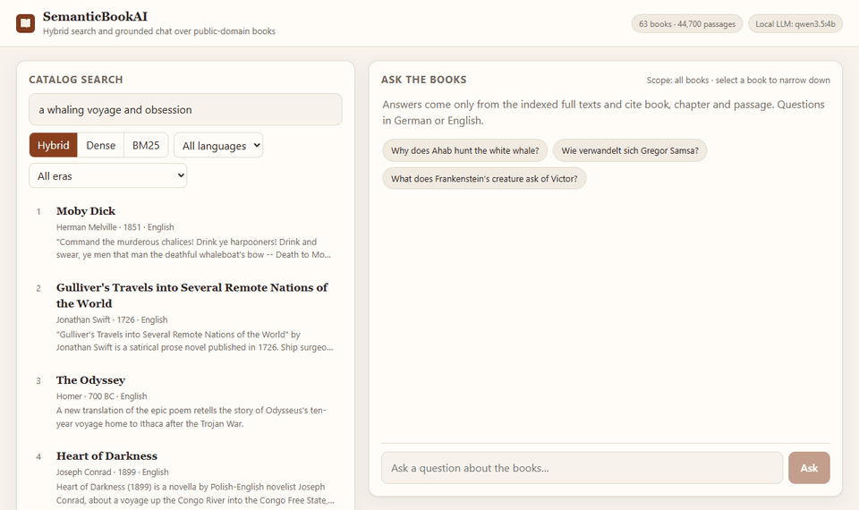
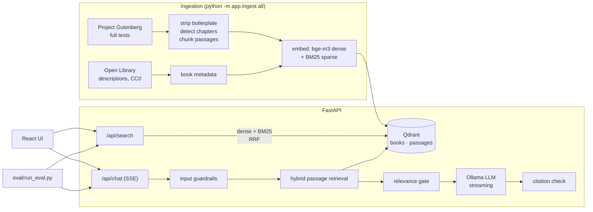

# SemanticBookAI

**Hybrid search and grounded chat over 63 public-domain books, running fully locally.**
Ask a question in English or German and get an answer that cites book, chapter and passage, or an honest
"not in the sources". No API keys and no cloud LLM: retrieval, embeddings and generation all run on your machine.



- **Two retrieval levels:** a hybrid catalog search over title, author, subjects and description (filters for
  language and era), and passage retrieval over 44,700 full-text passages for the chat.
- **Hybrid retrieval:** dense embeddings (`bge-m3`) and BM25 sparse vectors in Qdrant, fused with
  Reciprocal Rank Fusion (RRF, implemented and unit-tested in `backend/app/store.py`).
- **Grounded chat with streaming:** a local LLM (Ollama) answers only from the retrieved passages. Every claim
  carries a clickable citation `[n]` that opens the passage.
- **Guardrails:** prompt-injection filter, relevance gate before the LLM, refusal sentinel, citation
  validation, and an extractive fallback when the LLM is down.
- **Eval harness:** 24 answerable and 3 unanswerable questions plus 9 catalog queries, with retrieval metrics
  per mode and answer metrics per local model ([results](eval/results.md)).

## Quickstart

```bash
git clone https://github.com/mehmetaras2206/SemanticBookAI.git
cd SemanticBookAI
docker compose up                # CPU
# or, with an NVIDIA GPU:
docker compose -f docker-compose.yml -f docker-compose.gpu.yml up
```

Open <http://localhost:8080>. On first start the stack
1. pulls `bge-m3` (1.2 GB) and the chat model (`qwen3.5:4b`, 3.3 GB) into the Ollama volume, and
2. restores the prebuilt search index (133 MB, attached to the GitHub release) into Qdrant.

The status badge in the header shows when the model is ready. Everything is cached in Docker volumes, so later
starts take seconds. To build the index from the books yourself, set `INDEX_URL=` (empty). This takes about
15 minutes with a GPU and several hours on a CPU.

**Troubleshooting**

- *Larger model:* `LLM_MODEL=gemma4:12b docker compose up` (8 GB, fewer false refusals, see the eval). On Docker
  Desktop for Windows the WSL VM then needs about 12 GB of RAM; with a lower `memory=` limit in
  `%UserProfile%\.wslconfig` the model loads slowly or crashes and the chat falls back to showing passages.
- *Port 8080 in use* (on Windows often reserved by Hyper-V): `WEB_PORT=8088 docker compose up`.
- *First answer is slow:* the API loads the chat model at start-up; the header badge turns green when it is ready.

| Hardware | Chat speed (`qwen3.5:4b`) |
| --- | --- |
| NVIDIA RTX 3080 Ti (12 GB) | ~140 tokens/s, first token after ~0.5 s |
| CPU only | roughly 5–15 tokens/s depending on the CPU |

## Architecture



| Component | Choice | Why |
| --- | --- | --- |
| Vector DB | Qdrant 1.19 | named dense and sparse vectors per point, IDF modifier for BM25, payload filters |
| Dense embeddings | `bge-m3` via Ollama | strong multilingual retrieval (German and English), 8k context, runs on the GPU |
| Sparse | `Qdrant/bm25` (fastembed) | real BM25 term weighting; catches names and rare words that embeddings blur |
| Fusion | RRF, k = 60 | rank-based, no score normalisation between incompatible scales |
| LLM | Ollama, default `qwen3.5:4b` | smallest of three measured local models that meets every answer target (see below) |
| API | FastAPI, server-sent events | typed, async streaming |
| UI | React 19 + Vite + TypeScript | catalog search, retrieval-mode toggle, streaming chat, citation drawer |

### How a chat answer is produced

1. **Input guardrail:** empty, overly long or prompt-injection inputs (EN/DE patterns) are refused before
   any retrieval.
2. **Retrieval:** dense top-50 and BM25 top-50 passages are fused with RRF and the top 6 are kept.
   Passages are embedded with their book title and chapter so they stay findable by context.
3. **Relevance gate:** if no passage reaches a cosine similarity of 0.43, the API answers "not in the
   sources" without calling the LLM. The threshold is calibrated on the eval set, just below the lowest
   answerable question (0.47). The gate only catches clearly off-topic questions; the score ranges of
   answerable and unanswerable questions overlap, so the model's refusal sentinel is the second line of defence.
4. **Generation:** the system prompt demands an answer only from the numbered sources, a citation after every
   sentence, the language of the question, and the sentinel `NO_ANSWER` when the sources do not contain the
   answer. Tokens stream to the browser; the sentinel is held back and turned into a refusal.
5. **Citation check:** citations pointing to sources that were not delivered are stripped and reported, and
   answers without any citation are flagged.

## Evaluation

`python eval/run_eval.py --models qwen3.5:4b gemma4:e4b gemma4:12b`. Gold chapters and passages are not
hand-labelled: each question carries a verbatim evidence phrase, and the harness locates it in the corpus.

### Retrieval

Passage retrieval for the chat (24 questions, EN + DE, one cross-lingual, no book filter):

| Mode | Book R@1 | Book R@5 | Chapter R@5 | Evidence R@5 | MRR@10 |
| --- | --- | --- | --- | --- | --- |
| dense (`bge-m3`) | 1.00 | 1.00 | 0.67 | 0.50 | 1.00 |
| sparse (BM25) | 0.83 | 0.92 | 0.67 | 0.42 | 0.86 |
| **hybrid (RRF)** | **1.00** | **1.00** | **0.79** | 0.50 | **1.00** |

Catalog search (9 descriptive queries such as "Roman über den Niedergang einer Kaufmannsfamilie"):

| Mode | Recall@5 | MRR@10 |
| --- | --- | --- |
| dense | 1.00 | 0.86 |
| sparse | 0.78 | 0.68 |
| hybrid | 1.00 | 0.81 |

Hybrid search finds the right book first for every question and lifts chapter recall from 0.67 (dense or
BM25 alone) to 0.79: the two retrievers miss different chapters, and RRF keeps the hits of both. For catalog
queries made of descriptive paraphrases, dense alone ranks slightly better, because BM25 adds noise when no
query word appears in the metadata. Search latency is about 50 ms (query embedding, two Qdrant queries, RRF).

### Grounded answers

| Model | Correct overall | Correctness (answered) | Faithfulness | Citation validity | Unanswerable refused | False refusals | p50 first token | p50 tokens/s |
| --- | --- | --- | --- | --- | --- | --- | --- | --- |
| **`qwen3.5:4b`** (3.3 GB) | 0.62 | 0.83 | 1.00 | 1.00 | 3/3 | 6/24 | 0.46 s | 141 |
| `gemma4:e4b` (6.6 GB) | 0.60 | 0.72 | 1.00 | 1.00 | 3/3 | 4/24 | 0.38 s | 169 |
| `gemma4:12b` (8.0 GB) | 0.58 | 0.67 | 1.00 | 1.00 | 3/3 | 3/24 | 1.18 s | 111 |

24 answerable and 3 unanswerable questions, RTX 3080 Ti. *Correct overall* counts a refusal as 0, so it is what
a user actually gets. Faithfulness and correctness are graded by a local LLM-as-judge (`gemma4:12b`), so treat
them as indicative.

**Default model: `qwen3.5:4b`.** All three models meet the answer targets of the
[definition of done](docs/PROJECT_PLAN.md#6-optimales-ende-definition-of-done): 100 % citation validity, every
unanswerable question refused, faithfulness ≥ 0.8. Their overall correctness differs by less than run-to-run noise
(one question is 0.04; in an earlier run the order was reversed: 0.56 / 0.58 / 0.65). So the plan's rule applies:
the smallest model that meets every target. The one stable difference is caution: `qwen3.5:4b` declines 6–7 of 24
answerable questions, `gemma4:12b` only 1–3. With a 12 GB GPU, `LLM_MODEL=gemma4:12b` is the better demo.

**Tuning rounds:** (1) retrieving 12 instead of 6 passages moved no metric beyond noise, so the chat keeps 6
(smaller prompt, faster first token). (2) Some models declined in prose ("none of the passages state …") instead
of emitting the `NO_ANSWER` sentinel; a stricter instruction fixed the refusal rate for all three models.

**What limits correctness:** the models stay faithful. When the evidence passage is not among the retrieved
ones, they say so instead of guessing. Typical misses are questions whose wording differs from the text
("narrator of Moby Dick" vs. "Call me Ishmael"). The next step would be a cross-encoder reranker or query
rewriting (see future work).

## Local development

Requirements: Python 3.12+, Node 20+, Ollama, and Qdrant (Docker or binary).

```bash
docker compose -f docker-compose.yml -f docker-compose.dev.yml up -d qdrant
ollama pull bge-m3 && ollama pull qwen3.5:4b
cp .env.example .env                        # set QDRANT_URL=http://127.0.0.1:6333

cd backend
python -m venv .venv && .venv/Scripts/activate   # Linux/macOS: source .venv/bin/activate
pip install -r requirements-dev.txt
python -m app.ingest restore ../data/index.tar.gz   # or: python -m app.ingest all
uvicorn app.main:app --reload
pytest -q

cd ../frontend && npm install && npm run dev       # http://localhost:5173
```

`python -m app.ingest` stages: `prepare` (download and chunk), `index [--resume]` (embed and load),
`all`, `check`, `export [path]`, `restore <path-or-url>`.

## Project structure

```
backend/app/
  ingest/      text.py (boilerplate, chapters, chunking) · sources.py · prepare.py · index.py · snapshot.py
  store.py     Qdrant layout, embeddings, dense/sparse/hybrid search, RRF
  chat.py      grounded chat pipeline (SSE events: sources, token, refusal, fallback, done)
  guardrails.py, llm.py, main.py
backend/tests/ chunking and chapter detection, RRF, guardrails, API with faked retrieval/LLM
frontend/src/  App.tsx, api.ts (SSE parser), index.css
eval/          qa.jsonl, catalog.jsonl, run_eval.py, results.md
data/books.yaml  curated corpus (Gutenberg IDs and year of first publication)
docs/PROJECT_PLAN.md  scope, milestones and definition of done
```

## Data and licences

- Full texts: [Project Gutenberg](https://www.gutenberg.org), public domain in the USA. The
  [Project Gutenberg licence](https://www.gutenberg.org/policy/license.html) boilerplate is stripped during
  ingestion, as the licence allows for derived works.
- Book descriptions and subjects: [Open Library](https://openlibrary.org/developers/api) (CC0), with
  Gutenberg summaries as fallback.
- Code: MIT.

## Future work

- Cross-encoder reranking (e.g. `bge-reranker-v2-m3`) on the fused top 50 to lift evidence recall.
- Query rewriting for questions whose wording is far from the text.
- A larger human-labelled eval set; the judge is a local model of the same family as the candidates.
