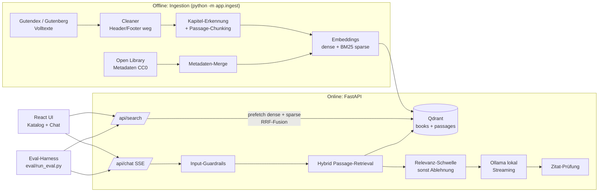

# SemanticBookAI – Projektdefinition: Start und Ziel

Stand: 2026-10-12 · Autor: Mehmet Aras (mit Claude Code)

Dieses Dokument ist die verbindliche Referenz für Umfang, Reihenfolge und Abnahme. Das Projekt ist
**fertig**, wenn alle Punkte der [Definition of Done](#6-optimales-ende-definition-of-done) erfüllt
sind – nicht früher und ausdrücklich auch nicht später (keine Feature-Erweiterung danach).

---

## 1. Zweck und Vision

SemanticBookAI wird in zwei Arbeitstagen zu einer vorzeigbaren RAG-Demo über 50 bis 100 gemeinfreie
Bücher: **hybride Katalogsuche** plus **grounded Chat mit Quellenangabe auf Kapitel und Passage**.

- **Zielgruppe der Demo:** Recruiter und technische Interviewer, die das HAIAR-Profil prüfen:
  Hybrid Search mit Reciprocal Rank Fusion (RRF), grounded Chat mit Streaming über ein **lokales LLM**, Guardrails, Eval-Harness.
- **Datenquellen:** [Project Gutenberg](https://www.gutenberg.org) (gemeinfreie Volltexte, Deutsch und
  Englisch, Zugriff über die [Gutendex-API](https://gutendex.com)) und
  [Open Library](https://openlibrary.org/developers/api) (Metadaten unter CC0: Beschreibung, Subjects,
  Erstveröffentlichungsjahr).
- **Zwei Retrieval-Ebenen:**
  1. *Katalogsuche* über Titel, Autor, Beschreibung, Subjects – Filter nach Sprache und Epoche.
  2. *Passage-Retrieval* im Volltext für den Chat; jede Antwort zitiert `[Buch, Kapitel, Passage]`.
- **Startbefehl für Dritte:** `docker compose up` → UI auf `http://localhost:8080`.
- **Leitprinzip:** Lieber ein kleiner, vollständig funktionierender und *gemessener* Umfang als viele
  halbfertige Features.

---

## 2. Optimaler Start

Der Start ist optimal, wenn Repo, Werkzeuge, Daten und LLM-Zugang stehen, bevor Anwendungscode entsteht.

### 2.1 Ausgangslage (geprüft am 2026-10-12)

| Voraussetzung | Ist-Zustand | Maßnahme |
| --- | --- | --- |
| Ordner `E:\SemanticBookAI` | leer, kein Git-Repo | `git init`, Grundstruktur |
| GitHub | `gh` angemeldet als `mehmetaras2206`, Repo existiert nicht | `gh repo create SemanticBookAI --public --source . --push` |
| Python | 3.14.2 lokal | lokal für Skripte/Tests; im Container Python 3.12 |
| Node.js | 24.13 / npm 11.6 | Vite + React + TypeScript |
| Docker | **nicht installiert** | Docker Desktop installieren (braucht WSL2). Bis dahin: Qdrant im Local Mode von `qdrant-client` |
| GPU | RTX 3080 Ti, 12 GB | nicht nötig; Embeddings per ONNX (`fastembed`) auf CPU |
| LLM | nur lokal, kein Cloud-LLM (Entscheidung 2026-10-12) | Ollama; Modell 3–8 GB, per Eval gewählt; nativ für Entwicklung, als Container in compose |
| WSL2 | Komponente „Plattform für virtuelle Computer“ fehlt, BIOS-Virtualisierung aktiv | `wsl --install --no-distribution` (Admin + Neustart), danach Docker Desktop |

### 2.2 Erste Schritte (in dieser Reihenfolge)

1. Repo-Grundstruktur: `.gitignore`, `.env.example`, `LICENSE` (MIT), `backend/`, `frontend/`,
   `data/`, `eval/`, `docs/`.
2. **Ingestion zuerst:** kuratierte Buchliste → Volltext laden → Gutenberg-Header/-Footer entfernen →
   Kapitel erkennen → Passagen chunken → Open-Library-Metadaten anreichern → JSONL in `data/processed/`.
3. Indexierung in Qdrant und ein Smoke-Test mit 5 Suchanfragen, **bevor** API und UI entstehen.
4. Danach: FastAPI → Frontend → Eval → Docker → README/GIF.
5. Nach jedem Meilenstein: Tests grün, Commit, Push auf `main`.

---

## 3. Architektur

### 3.1 Technologie-Stack

| Schicht | Wahl | Begründung |
| --- | --- | --- |
| Vektor-DB | Qdrant 1.19 (Docker) | Named Vectors dense + sparse, IDF-Modifier für BM25, Payload-Filter |
| Dense Embeddings | `bge-m3` über Ollama (1024 Dim.) | stark mehrsprachig (DE + EN), 8k Kontext, läuft auf der GPU |
| Sparse | `fastembed` `Qdrant/bm25` + Qdrant-IDF-Modifier | echtes BM25-Scoring in Qdrant |
| Fusion | Reciprocal Rank Fusion, k = 60, eigene Implementierung in `store.py` | Standardverfahren, ohne Score-Normalisierung, unit-getestet |
| Backend | FastAPI, Pydantic v2, SSE über `StreamingResponse` | schlank, typisiert, async |
| LLM | Ollama, Standard `gemma4:12b`; Kandidaten `qwen3.5:4b` / `gemma4:e4b` per `.env` | lokal, keine Secrets, kein Key für Dritte, on-premise-fähig |
| Frontend | Vite + React + TypeScript, ohne UI-Framework | schlank, schneller Build |
| Auslieferung | `docker compose`: `qdrant`, `ollama` (GPU optional), `api`, `web` (nginx) | ein Startbefehl, kein API-Key |
| Tests | `pytest` (Backend), `tsc` + Build (Frontend) | |

### 3.2 Datenmodell

- **Collection `books`** (eine Zeile pro Buch): `book_id`, `title`, `author`, `language` (`en`/`de`),
  `year` (Erstveröffentlichung), `era` (z. B. `pre-1800`, `1800-1849`, `1850-1899`, `1900+`),
  `subjects`, `description`, `gutenberg_url`. Vektoren: `dense` über *Titel + Autor + Beschreibung +
  Subjects*, `bm25` über denselben Text.
- **Collection `passages`**: `book_id`, `title`, `author`, `language`, `chapter_idx`, `chapter_title`,
  `passage_idx`, `text` (ca. 800–1200 Zeichen, 15 % Überlappung). Vektoren: `dense`, `bm25`.

### 3.3 API

| Methode | Pfad | Zweck |
| --- | --- | --- |
| GET | `/api/health` | Status, Anzahl Bücher/Passagen, LLM-Modus |
| GET | `/api/search?q=&language=&era=&mode=hybrid\|dense\|sparse&limit=` | Katalogsuche |
| GET | `/api/books/{book_id}` | Buchdetails + Kapitelliste |
| POST | `/api/chat` (SSE) | `{question, book_id?, history?}` → Events `sources`, `token`, `done`, `refusal` |

---

## 4. Umfang

### 4.1 In-Scope

- 60 kuratierte Bücher (ca. 40 Englisch, ca. 20 Deutsch), mindestens vier Epochen.
- Ingestion-Pipeline, idempotent und wiederholbar; verarbeitete Daten werden im Docker-Build bzw.
  beim ersten Start erzeugt (nicht ins Repo committet, außer der Buchliste).
- Hybride Katalogsuche mit Sprach- und Epochenfilter, Umschalter `hybrid / dense / sparse` in der UI
  (macht den Nutzen von RRF sichtbar).
- Chat über alle Bücher oder ein ausgewähltes Buch; Streaming; klickbare Zitate, die die Passage zeigen.
- Guardrails:
  - Eingabe: Längenlimit, einfache Prompt-Injection-Erkennung, leere Eingaben.
  - Retrieval: Relevanz-Schwelle; darunter Antwort „steht nicht in den Quellen“ statt Halluzination.
  - Ausgabe: Prüfung, dass jede Zitatnummer auf eine gelieferte Quelle zeigt; ungültige werden entfernt
    und gemeldet.
  - System-Prompt: nur aus Quellen antworten, Sprache der Frage verwenden.
- Eval-Harness mit 20+ Frage-Antwort-Paaren inkl. 3 nicht beantwortbarer Fragen.
- `docker compose up` startet alles; README auf Englisch mit Architekturdiagramm, Eval-Tabelle, GIF.
- CI: GitHub Actions führt Backend-Tests und Frontend-Build aus.

### 4.2 Nicht-Ziele (Out-of-Scope)

- Benutzerkonten, Authentifizierung, Persistenz von Chat-Verläufen.
- Deployment in die Cloud, Skalierung, Monitoring.
- Reranker-Modelle (Cross-Encoder), Fine-Tuning, Agenten/Tool-Use.
- Mehr als 100 Bücher, andere Sprachen als Deutsch und Englisch.
- Pixelperfektes Design, Mobile-Optimierung über „benutzbar“ hinaus.
- Eigene BM25-Implementierung (Qdrant-IDF-Modifier genügt).

---

## 5. Meilensteine

| # | Meilenstein | Ergebnis / Prüfung | Zeit |
| --- | --- | --- | --- |
| M0 | Setup | Repo auf GitHub, Struktur, Plan-Dokument | 0,5 h |
| M1 | Ingestion | `data/processed/books.jsonl` + `passages.jsonl`; ≥ 55 Bücher, Kapitel erkannt | 3 h |
| M2 | Index + Retrieval | Qdrant befüllt; Smoke-Test: 5 Anfragen liefern plausible Treffer | 2 h |
| M3 | API | `/api/search`, `/api/books`, `/api/chat` (SSE) + pytest grün | 3 h |
| M4 | Frontend | Katalogsuche mit Filtern, Chat mit Streaming und Zitaten | 3 h |
| M5 | Eval | `eval/qa.jsonl` (20+), `eval/run_eval.py`, Ergebnisse in `eval/results.md` | 2 h |
| M6 | Docker | `docker compose up` von frischem Klon funktioniert | 1,5 h |
| M7 | Doku + Release | README (EN), Architekturdiagramm, GIF, CI grün, Tag `v1.0.0` | 1,5 h |

Abhängigkeiten: M1 → M2 → M3 → (M4, M5 parallel möglich) → M6 → M7.

---

## 6. Optimales Ende: Definition of Done

Das Projekt ist abgeschlossen, wenn **jeder** Punkt prüfbar erfüllt ist:

### Funktion
- [ ] `git clone` + `cp .env.example .env` + `docker compose up` startet Qdrant, API und UI ohne
      weitere Handgriffe; die UI ist unter `http://localhost:8080` erreichbar.
- [ ] Der Index enthält 50–100 Bücher in Deutsch und Englisch aus mindestens vier Epochen.
- [ ] Katalogsuche liefert Ergebnisse in < 500 ms (lokal, warm) und filtert korrekt nach Sprache und Epoche.
- [ ] Umschalter `hybrid / dense / sparse` funktioniert und zeigt unterschiedliche Rankings.
- [ ] Chat streamt Tokens sichtbar; jede inhaltliche Antwort enthält mindestens ein Zitat
      mit Buch, Kapitel und Passage; Klick auf das Zitat zeigt den Passage-Text.
- [ ] Fragen ohne Grundlage in den Quellen werden abgelehnt statt halluziniert.
- [ ] Ist Ollama nicht erreichbar oder das Modell noch nicht geladen, zeigt die UI einen klaren Hinweis und liefert die Top-Passagen (extraktiver Fallback) statt eines Fehlers.

### Qualität (Eval)
- [ ] `python eval/run_eval.py` läuft durch und schreibt `eval/results.md`.
- [ ] Hybrid erreicht **Recall@5 (Buch-Ebene) ≥ 0,85** und ist bei MRR mindestens so gut wie
      dense-only und sparse-only (Vergleichstabelle im README).
- [ ] Kapitel-Treffer: **Recall@5 (Kapitel-Ebene) ≥ 0,60**.
- [ ] Mit dem Standardmodell: **Zitat-Gültigkeit 100 %** (kein Zitat auf nicht gelieferte Quellen), alle 3
      unbeantwortbaren Fragen korrekt abgelehnt, Faithfulness (lokales LLM-as-Judge) ≥ 0,8.
- [ ] Vergleichstabelle der drei Kandidatenmodelle (Antwortmetriken + Tokens/s) im README; Standardmodell nach der (ergänzten) Regel in Abschnitt 8 gewählt.

### Engineering
- [ ] Backend-Tests (`pytest`) grün, inklusive Chunking, RRF-Logik, Guardrails, API-Endpunkte.
- [ ] Frontend baut ohne TypeScript-Fehler.
- [ ] GitHub Actions CI grün auf `main`.
- [ ] Keine Secrets im Repo; `.env.example` dokumentiert alle Variablen.

### Präsentation
- [ ] README auf Englisch: Pitch, GIF der Demo, Architekturdiagramm (Mermaid), Quickstart,
      Eval-Ergebnisse, Designentscheidungen, Datenlizenzen.
- [ ] Repo öffentlich auf GitHub, Beschreibung und Topics gesetzt, Release `v1.0.0`.

**Stopp-Regel:** Sind alle Haken gesetzt, wird nichts Neues mehr gebaut. Ideen landen im Abschnitt
„Future work“ des README.

---

## 7. Eval-Harness

**Datensatz `eval/qa.jsonl`** – je Zeile: `id`, `question`, `language`, `gold_book_id`,
`gold_chapter_idx` (optional), `answerable` (bool), `reference_answer`, `keywords`.
Mischung: ca. 14 Englisch, ca. 6 Deutsch, 3 unbeantwortbar; Fragetypen: Fakt, Figur, Ort, Handlung,
Katalogsuche („Roman über Walfang“).

| Metrik | Ebene | Messung | Zielwert |
| --- | --- | --- | --- |
| Recall@5 (Buch) | Retrieval | Gold-Buch unter Top-5-Passagen | ≥ 0,85 (hybrid) |
| Recall@5 (Kapitel) | Retrieval | Gold-Kapitel unter Top-5 | ≥ 0,60 |
| MRR@10 | Retrieval | Kehrwert des ersten Treffer-Rangs | hybrid ≥ max(dense, sparse) |
| Zitat-Gültigkeit | Antwort | gültige / alle Zitate | 1,00 |
| Ablehnungs-Korrektheit | Antwort | unbeantwortbar korrekt abgelehnt | 3/3 |
| Faithfulness | Antwort | LLM-as-Judge, 0–1 | ≥ 0,80 |
| Latenz | System | p50 Suche / Time-to-first-token Chat | < 0,5 s / < 3 s |

Retrieval-Metriken laufen ohne LLM; Antwort-Metriken brauchen ein laufendes Ollama (sonst als „skipped“ markiert).
LLM-as-Judge läuft ebenfalls lokal (gleiches Modell); diese Einschränkung wird im README offen benannt.

---

## 8. Risiken, Entscheidungen und Stoppkriterien

| Risiko | Auswirkung | Gegenmaßnahme |
| --- | --- | --- |
| Docker nicht installiert | `docker compose up` nicht testbar | Docker Desktop installieren; bis dahin Local Mode |
| Lokales Modell schwächer als Cloud-LLMs | ungenauere Antworten, Zitatfehler | strikter Prompt, Zitat-Guardrail, Relevanz-Schwelle, Eval misst es offen |
| Dritte ohne GPU | langsame Antworten (CPU) | GPU in compose optional; README nennt erwartete Geschwindigkeit; kleineres Modell per `.env` |
| Modell-Download ca. 8 GB | langer Erststart | `ollama-pull`-Init-Service, Volume-Cache, Fortschritt in `/api/health` |
| Kapitel-Erkennung unsauber (heterogene Gutenberg-Formate) | schlechte Zitate | Regex für `CHAPTER`, `Kapitel`, römische Ziffern; Fallback: feste Abschnitte „Teil n“ |
| Gutenberg-Rate-Limits | Ingestion langsam | Cache in `data/raw/`, höfliche Pausen, Mirror-URLs |
| Open Library ohne Beschreibung | dünne Katalogtexte | Fallback auf Subjects + erste Absätze |
| Embedding auf CPU langsam | lange Indexierung | Embeddings über Ollama auf der GPU (ca. 45/s); vorgebauter Index als Release-Asset `index-v1` für Dritte |
| Docker-Image groß durch Modelle | langer Build | Modell-Cache als Volume, Index beim ersten Start bauen |

**Getroffene Entscheidungen:**
- Name und Repo: `SemanticBookAI`, öffentlich unter `mehmetaras2206`.
- Sprache von Code/README: Englisch; dieses Planungsdokument: Deutsch.
- LLM: ausschließlich lokal über Ollama, Modell über `LLM_MODEL` in `.env`. Kein Cloud-LLM, keine Secrets im Projekt.
- Modellwahl datengetrieben: Kandidaten `qwen3.5:4b` (ca. 3,3 GB), `gemma4:e4b` (ca. 6,6 GB), `gemma4:12b` (ca. 7,7 GB). Standard wird das **kleinste** Modell, das alle Antwort-Zielwerte der Definition of Done erreicht. Tabelle Größe vs. Qualität vs. Tokens/s im README.
- Entwicklung nativ (Ollama für Windows), Qdrant im Container; Abnahme über `docker compose`.

**Abweichungen während der Umsetzung (2026-10-13):**
- *Dense-Embeddings:* `paraphrase-multilingual-MiniLM` (nur kurze Sequenzen trainiert) und `jina-embeddings-v2-base-de`
  (auf der CPU unter 7 Passagen/s, also Stunden) wurden verworfen. `bge-m3` läuft über das ohnehin vorhandene
  Ollama auf der GPU.
- *Qdrant Local Mode* wird beim Einfügen mit wachsender Collection immer langsamer; das Qdrant-Windows-Binary
  scheiterte am Optimizer (Datei-Umbenennung, Zugriff verweigert). Deshalb läuft Qdrant im Container.
- *Vorgebauter Index:* `python -m app.ingest export/restore` und das Release-Asset `index-v1` (135 MB). So startet
  `docker compose up` ohne stundenlanges Embedding auf der CPU.
- *Modellwahl:* Im finalen Lauf erfüllen alle drei Kandidaten die Antwort-Zielwerte. Die Regel „kleinstes Modell“
  hätte `qwen3.5:4b` gewählt, das aber 7 von 24 beantwortbaren Fragen ablehnt. Die Regel wurde um die Kennzahl
  „korrekt insgesamt“ (Ablehnung zählt 0) ergänzt; danach ist `gemma4:12b` Standard (0,65 gegenüber 0,56/0,58,
  1 von 24 Fehlablehnungen).
- *Winnetou I* gibt es auf Gutenberg nur als Hörbuch; der Korpus hat daher 63 statt 64 Bücher.

**Stoppkriterien (wann Schluss ist):**
1. Alle Haken der Definition of Done gesetzt → Ende, Release `v1.0.0`.
2. Ein Zielwert der Eval wird nach zwei Verbesserungsrunden nicht erreicht → Wert ehrlich im README
   dokumentieren, Ursache nennen, trotzdem abschließen.
3. Blocker außerhalb meiner Kontrolle (Docker-/WSL-Installation, Neustart) → alles andere fertigstellen,
   Blocker im README und hier dokumentieren.
